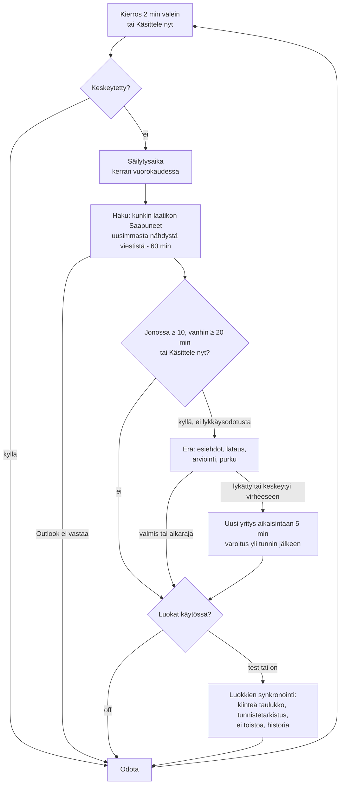

# Paikallinen AI-avustaja Classic Outlookiin

Toteutussuunnitelma, 17.11.2026 (päivitetty samana päivänä infrastruktuurikatselmoinnin jälkeen)

## Tavoite ja päätökset

Windows-käyttäjäistunnossa toimiva sovellus seuraa käyttäjän valitsemia Classic Outlookin postilaatikoita. Tilit ovat pääosin M365-tilejä, mukana yksi Gmail-tili. Sovellus lukee viestit nykyisen Outlook-profiilin kautta, arvioi ne paikallisella kielimallilla ja kokoaa huomiota vaativat viestit yhteen näkymään. M365-viesteille voidaan lisätä Outlook-luokkia.

Sovellus ei kerää salasanoja eikä kopioi Outlookin kirjautumistunnisteita. Se käyttää Outlookin objektimallia käyttäjän olemassa olevassa istunnossa. Outlook vastaa tilien kirjautumisesta ja synkronoinnista. Erillistä Graph-sovellusrekisteröintiä ei tässä toteutuksessa tarvita. Organisaation paikalliset käyttö- ja tietojenkäsittelyrajoitukset sekä Outlookin ohjelmallisen käytön suojausasetukset voivat silti vaikuttaa toimintaan.

Suositus: C#/.NET 10, Outlook COM -sovitin, salattu SQLite ja LM Studio paikallisena mallipalvelimena. Mallisovitin käyttää OpenAI-yhteensopivaa rajapintaa, joten Ollama voidaan myöhemmin liittää vaihtoehtoisena palvelimena. Malli ladataan vain eräajon ajaksi eikä sitä pidetä muistissa. Ensimmäinen käyttöliittymä on yksinkertainen Windowsin WPF-sovellus; erillistä React-palvelinta ei tarvita.

## Nykyinen ympäristö

Sovellus ajetaan koneella [koti-pc](../documentation-repo/hosts/koti-pc.md). Alla olevat tiedot on tarkistettu dokumentaatiosta ja koneelta 17.11.2026.

| Asia | Tila | Vaikutus suunnitelmaan |
| --- | --- | --- |
| Käyttöjärjestelmä | Windows 11 Home, build 26300 | Ei BitLockeria eikä ryhmäkäytäntöeditoria |
| Outlook | Classic Outlook x64, Click-to-Run 16.0.20527, Microsoft 365 -kuluttajalisenssi | COM-objektimalli käytettävissä; koneella ei ole Outlookin suojauskäytäntöjä |
| Virustorjunta | Microsoft Defender päällä ja ajan tasalla | Ohjelmallisen käytön suojauksen ei pitäisi kysyä lupaa; varmistetaan vaiheessa 1 |
| Outlookin välimuisti | 6 OST-tiedostoa, yhteensä 7,4 Gt, salaamattomalla levyllä | Ks. Salaus |
| Levyn salaus | Ei käytössä asemilla C: eikä E: | Sovelluksen tietokanta salataan itse |
| Laitteisto | Ryzen 7 3700X, 32 Gt RAM, RTX 2070 SUPER 8 Gt | Yksi malliajo kerrallaan, näytönohjain jaetaan Automatic1111:n kanssa |
| .NET | .NET 10 SDK 10.0.404 ja ajoympäristöt 10.0.15 asennettu; vanha .NET 6 -ajoympäristö jäljellä | WPF-, konsoli- ja xUnit-pohjat käytettävissä |
| LM Studio | Käynnistyy käyttäjän `kortt` kirjautuessa, kuuntelee `0.0.0.0:1234` ilman tunnistautumista. Kehotteiden lokitus (`logSensitiveData`) ja `verbose` kytketty pois 17.11.2026 | Poiskytkentä todettu testiviestillä; tarkistetaan uudelleen LM Studion päivitysten jälkeen |
| LM Studion mallit | Mm. Gemma 4 12B QAT, Gemma 4 E4B, Qwen 3.5 9B; suomenkielinen vertailu 2.10.2026 | Mallit ja vertailutyökalu ovat valmiina |
| Ollama | Kuuntelee kaikissa osoitteissa (`OLLAMA_HOST=0.0.0.0:11434`), vain `llama3.1:8b` | Ei käytetä ensimmäisessä versiossa |
| Muut GPU-käyttäjät | Automatic1111 + A1111 Prompter (tuotanto); Prompterin kehoteavustaja käyttää LM Studiota | Eräajo väistää kuvagenerointia ja Prompterin mallia |
| Tilit | Interaktiivinen käyttäjä `kortt`; Prompter ja GitHub-runner ajetaan tilillä `Martti-local` | Sovellus ajetaan käyttäjänä `kortt` |
| Varmuuskopiointi | Käyttäjän `AppData\Local` ei kuulu restic-varmuuskopioihin | Ks. Säilytys ja varmuuskopiointi |

## Paikallisuuden rajaus

- Viestien analyysi tapahtuu omalla koneella ladatulla mallilla.
- Arviot ja käsittelytila tallennetaan salattuun tietokantaan käyttäjän paikalliseen AppData-hakemistoon, ei OneDrive-kansioon.
- Tavallinen sähköpostisynkronointi tapahtuu edelleen Microsoftin ja Googlen palveluihin.
- Outlookiin lisätyt luokat synkronoituvat M365-postilaatikkoon. Jos myös AI:n tuottamien merkintöjen pitää pysyä kokonaan paikallisina, valitaan pelkkä paikallinen näkymä.
- Gmailin IMAP-viesteille käytetään paikallisia luokituksia: Outlookin väriluokkia ei oleteta tuetuiksi eikä niitä muuteta Gmail-tunnisteiksi.
- Pilvimallia ei käytetä varavaihtoehtona. Mallipalvelimen puuttuessa työ jää jonoon.
- Sovelluksen mallisovitin hyväksyy vain loopback-osoitteet (`127.0.0.1`, `::1`) eikä seuraa uudelleenohjauksia tai välityspalvelimia.
- LM Studion palvelin on avoinna lähiverkkoon, koska Ullis käyttää sitä. Viestien sisältö ei näy muille rajapinnan kautta, joten avoimuus koskee vain mallin käyttöoikeutta. Sisällön paikallisuus edellyttää, että LM Studion kehotteiden lokitus on pois päältä. Tämä tarkistetaan ennen jokaista eräajoa, jos asetus on luettavissa, ja muuten käyttöönoton tarkistuslistalla.

## Käyttökokemus

Ensimmäisellä käynnistyskerralla sovellus näyttää Outlook-profiilissa näkyvät tietovarastot ja kansiot. Käyttäjä valitsee seurattavat laatikot ja kansiot sekä mallin. Jaetut laatikot otetaan mukaan vain siltä osin kuin ne ovat Outlookissa käytettävissä nykyisillä oikeuksilla.

Alkuun tarjotaan 100–200 viimeaikaisen viestin kokeilu. Luokitukset näkyvät ensin vain sovelluksessa. Käyttäjä voi korjata niitä ja ottaa myöhemmin käyttöön Outlook-luokkien lisäämisen.

Päänäkymässä on kaikkien valittujen laatikoiden yhteinen lista: laatikko, lähettäjä, otsikko, arvioitu toimenpide, kiireellisyys, mahdollinen määräaika ja lyhyt yhteenveto. Viestin voi avata Outlookiin. Saatavilla ovat suodattimet Vastattava, Tehtävä, Odottaa muita ja Tarkista sekä luokituksen korjaus. Näkyvissä ovat myös viimeisen onnistuneen tarkistuksen aika, jonon koko, seuraavan eräajon arvioitu aika tai sen lykkäyksen syy sekä laatikkokohtaiset virheet. Painike "Käsittele nyt" käynnistää eräajon heti. Sovelluksen voi keskeyttää.

## Arkkitehtuuri

| Osa | Vastuu |
| --- | --- |
| Outlook-sovitin | Laatikoiden ja kansioiden luettelo, viestien luku, avaaminen Outlookissa ja rajatut luokkamuutokset |
| Tarkistusajastin | Kevyt COM-tarkistus kahden minuutin välein; uudet viestit jonoon ilman malliajoa |
| Eräajon ohjaus | Erän käynnistysehdot, GPU-tilanteen tarkistus, mallin lataus ja purku, uudelleenyritykset |
| Sisällön valmistelu | Pelkkä teksti, pituusrajat, turvallinen katkaisu ja tarvittava keskustelukonteksti |
| Mallisovitin | OpenAI-yhteensopiva chat-rajapinta (LM Studio), mallin lataus ja purku LM Studion REST-rajapinnalla, aikakatkaisu ja JSON Schema -vastauksen tarkistus |
| Säännöt ja toimintalogiikka | Sallitut luokat, käyttäjän korjausten etusija ja Outlookiin kirjoittamisen ehdot |
| Salattu SQLite | Viitteet, käsittelytila, arviot, käyttäjän korjaukset ja muutoshistoria |
| WPF-käyttöliittymä | Yhteinen viestilista, tarkastaminen ja asetukset |

Outlook COM -kutsut hoidetaan omalla STA-säikeellä ja tarvittavalla viestipumpulla. COM-olioita ei siirretä mallityöntekijöille: niille annetaan tavallisia tekstimuotoisia tietoja. Mallin odotus ei saa pysäyttää käyttöliittymää tai Outlook-käsittelyä. Viestit luetaan pienissä erissä ja COM-viittaukset vapautetaan hallitusti.

### Outlook COM -toteutuksen yksityiskohdat

- Sovellus liittyy käynnissä olevaan Outlookiin. .NET 5:stä alkaen `Marshal.GetActiveObject` puuttuu, ja `new Application()` käynnistäisi suljetun Outlookin. Siksi ensin tarkistetaan `OUTLOOK.EXE`-prosessi ja liitytään vasta sen jälkeen. Outlook toimii omassa prosessissaan, joten sovelluksen bittisyydellä ei ole väliä.
- Sovellus ja Outlook ajetaan samalla oikeustasolla ilman järjestelmänvalvojan oikeuksia. Oikeustasojen ero estää COM-yhteyden.
- Outlookin interop-tyypit (NuGet `Microsoft.Office.Interop.Outlook`) upotetaan ohjelmaan (`EmbedInteropTypes`). Muuten .NET 10 yrittää ladata ajon aikana `office.dll`-kokoonpanon, eikä löydä sitä.
- Kansion viestit luetellaan `Folder.GetTable()`-taululla. Sarakkeiksi haetaan EntryID, ReceivedTime, LastModificationTime ja `PR_INTERNET_MESSAGE_ID`, jolloin kaikkia viestejä ei tarvitse avata. Aikasuodatus tehdään DASL-kyselynä (`urn:schemas:httpmail:datereceived`), koska `Restrict` riippuu alueasetusten päivämäärämuodosta.
- Taulun `EntryID`-sarake palauttaa Exchange-laatikoissa lyhytaikaisen tunnisteen (48 merkkiä), joka on voimassa vain istunnon ajan. Tallennettava pitkäaikainen tunniste (140 merkkiä) luetaan sarakkeesta `http://schemas.microsoft.com/mapi/proptag/0x66700102` (`PR_LONGTERM_ENTRYID_FROM_TABLE`, muunnos `Row.BinaryToString`). Se on sama kuin viestiobjektin `EntryID`, ja viesti avautuu sillä.
- COM-kokoelmat (`Accounts`, `Stores`, `Folders`) käydään läpi indekseillä eikä `foreach`-silmukalla. `foreach`-läpikäynnillä Gmail-tietovarasto ei yhdistynyt IMAP-tiliinsä, indekseillä se yhdistyi.
- `Body` ja `SenderEmailAddress` kuuluvat ohjelmallisen käytön suojauksen piiriin. Niiden toiminta ilman kehotteita on vaiheen 1 hyväksymisehto.
- IRM- tai OME-salatun viestin tekstiä ei välttämättä voi lukea. Tällainen viesti merkitään tilaan Tarkista eikä sitä luokitella sisällön perusteella.
- Gmailista seurataan vain Saapuneet-kansiota ja käyttäjän valitsemia kansioita, ei kansiota `[Gmail]/Kaikki viestit`. Jos IMAP-tili lataa vain otsikot, tekstiä ei ole saatavilla ja viesti merkitään tilaan Tarkista.
- Luokan lisääminen muuttaa LastModificationTime-arvoa. Uusi malliajo tehdään vain, jos sisältötiiviste muuttuu.

## Viestien löytäminen ja käsittely

1. Alussa luetellaan kaikki valitut tietovarastot; pelkkä profiilin oletus-Inbox ei riitä. Mukaan voidaan valita myös kansiot, joihin Outlook-säännöt siirtävät saapuneita viestejä.
2. Tarkistus tehdään oletuksena kahden minuutin välein. Se lukee vain Outlookia ja lisää uudet viestit jonoon; mallia ei kutsuta. Käynnistyessä ja lepotilasta palattaessa tehdään kiinniottotarkistus.
3. Kansiokohtainen tarkistuspiste ja päällekkäinen aikaikkuna löytävät viiveellä näkyvät viestit. Lisäksi tehdään rajattu viime päivien täsmäytys. Näitä verrataan tietokannan käsittelytilaan; koko laatikkoa ei lueta joka kierroksella.
4. Viestistä luetaan lähettäjä, vastaanottajat, otsikko, vastaanottoaika ja tekstisisältö. Viestiä ei merkitä luetuksi. Muiden Outlook-kohteiden kuin sähköpostien käsittely ohitetaan alussa.
5. Sääntöosuma voi ohittaa mallin vain selkeissä käyttäjän määrittelemissä tapauksissa, kuten tietyn uutiskirjeen kohdalla. Sääntöosumat käsitellään heti, eräajoa odottamatta.
6. Jonossa olevat viestit käsitellään eräajona (ks. seuraava luku). Viestin teksti luetaan Outlookista uudelleen eräajon aikana, joten raakatekstiä ei säilytetä jonossa.
7. Malli tuottaa rakenteisen arvion, joka tarkistetaan ohjelmallisesti. Virheellinen vastaus voidaan yrittää kerran uudelleen; jatkuva virhe näkyy tarkistettavana eikä onnistuneena luokituksena.
8. Tulos tallennetaan ja mahdolliset sallitut Outlook-luokat lisätään erillisessä kirjoitusvaiheessa.

Tunnistuksessa säilytetään StoreID ja EntryID avaamista varten, mutta niitä ei käsitellä ikuisesti pysyvinä tunnisteina. Siirrot ja kopiot huomioidaan laatikkokohtaisilla lisätiedoilla, kuten Internet Message-ID:llä ja sisältötiivisteellä. Message-ID voi puuttua tai esiintyä kopioissa: yksinään se ei riitä. Epäselvässä tapauksessa vältetään kirjoittamista väärään viestiin. Pelkkä AI-luokan lisäämisen aiheuttama muutos ei saa käynnistää uutta malliajoa.

Ensimmäinen versio arvioi uuden viestin, ei lupaa täydellistä keskustelun tehtävätilaa. Odottaa muita -tilan ja vastattu/hoidettu-päätelmien luotettava ylläpito edellyttää myöhemmin myös lähetettyjen viestien ja ketjujen seurantaa.

## Eräkäsittely ja GPU:n jakaminen

Mallia ei pidetä muistissa. Mallin lataaminen vie LM Studion mittauksissa noin 36–80 sekuntia, joten viestejä ei käsitellä yksi kerrallaan heti saapuessaan, vaan ne kootaan eriksi.

**Erän käynnistys.** Eräajo alkaa, kun jokin seuraavista toteutuu:
- jonossa on vähintään 10 viestiä,
- vanhin jonossa oleva viesti on odottanut 20 minuuttia,
- käyttäjä painaa "Käsittele nyt".

Raja-arvot ovat säädettäviä. Oletuksilla kiireellinen viesti näkyy arvioituna viimeistään noin 20–25 minuutin kuluttua saapumisesta. Raja-arvot säädetään vaiheessa 5 käytännön kokemuksen mukaan.

**Ennen latausta tarkistetaan:**
1. Automatic1111 ei generoi kuvaa. Tämä luetaan rajapinnasta `http://127.0.0.1:7860/sdapi/v1/progress`; jos rajapinta ei vastaa, Automatic1111:n katsotaan olevan vapaana.
2. LM Studiossa ei ole ladattuna muuta mallia, kuten Prompterin kehoteavustajan mallia. Kaksi mallia ei mahdu yhtä aikaa 8 Gt:n näytönohjaimeen.

Jos jompikumpi ehto ei täyty, erää lykätään ja yritetään uudelleen muutaman minuutin kuluttua. Lykkäyksen syy näytetään käyttöliittymässä. Jos erää on lykätty yli tunnin, lykkäys näytetään varoituksena; kuvagenerointia ei kuitenkaan keskeytetä.

**Erän aikana:**
- Sovellus lataa mallin LM Studion REST-rajapinnalla (`POST /api/v1/models/load`) valitulla kontekstipituudella (aluksi 8192) ja ottaa talteen ladatun instanssin tunnisteen. Tunniste on ensimmäisellä latauksella sama kuin mallin nimi, joten sovellus pitää instanssia omanaan vain, jos samaa mallia ei ollut ladattuna ennen latausta.
- Viestit käsitellään yksi kerrallaan. Ennen jokaista viestiä tarkistetaan Automatic1111:n tila. Jos generointi alkaa, erä keskeytetään hallitusti ja jäljellä olevat viestit jäävät jonoon.
- Yhden erän enimmäiskesto on oletuksena 15 minuuttia. Pitkä kiinniotto, kuten loman jälkeen kertynyt jono, käsitellään useana eränä, joiden välillä näytönohjain vapautetaan.

**Erän jälkeen** sovellus purkaa vain itse lataamansa instanssin. Purku tehdään myös virhetilanteissa ja sovellusta suljettaessa. Varmuuden vuoksi latauspyynnössä asetetaan lyhyt käyttämättömyysaika (TTL), jolloin LM Studio purkaa mallin itse, vaikka sovellus kaatuisi.

**Mitattu nopeus** (vaihe 2, 180 oikeaa viestiä, Gemma 4 12B QAT): mediaani 11,6 s viestiä kohden ja 90 % viesteistä alle 14,5 s. Mallin lataus kesti 7–14 s, kun malli oli levyvälimuistissa, ja kylmänä noin 80 s. 15 minuutin erään mahtui 72–81 viestiä, ja koko otos vei kolme erää eli noin 36 minuuttia. Gemma 4 E4B oli keinotekoisella aineistolla noin 6 s viestiä kohden.

## Luokittelumalli

| Kenttä | Esimerkkejä / käytäntö |
| --- | --- |
| Aihe | Työ, sijoitukset, hallinto, henkilökohtainen, uutiskirje, muu; käyttäjän muokattavissa |
| Toimenpide | Vastattava, tehtävä, tiedoksi, tarkista; myöhemmin odottaa muita |
| Kiireellisyys | Tänään, tällä viikolla, myöhemmin, ei määräaikaa |
| Määräaika | Vain viestistä perusteltava päivämäärä; muuten null |
| Yhteenveto | 1–2 virkettä suomeksi |
| Perustelu | Lyhyt selitys ja tarvittaessa viestin tekstikohta |
| Tarkistettava | Puuttuva konteksti, epäselvä pyyntö, katkaistu sisältö tai ristiriita |

Määräaika ja kiireellisyys pidetään erillään. Mallille annetaan nykyinen aika Europe/Helsinki-aikavyöhykkeellä ja viestin päiväys. Mallin omaa numeerista varmuutta ei käytetä sellaisenaan automaation turvallisuusrajana.

Outlookissa käytetään aluksi vain toimintaluokkia AI: Vastattava, AI: Tehtävä, AI: Tiedoksi ja AI: Tarkista. Sovellus muuttaa vain omia nimettyjä luokkiaan ja säilyttää muut. Luokkien erotin käsitellään Outlookin alueasetusten mukaan. Nykyiset luokat luetaan uudelleen juuri ennen tallennusta. Käyttäjän sovelluksessa tekemä korjaus lukitsee kyseisen arvion automaattiselta ylikirjoitukselta, kunnes käyttäjä pyytää uutta arviota.

## Malli ja mallipalvelin

LM Studio on päämallipalvelin, koska:
- Ehdokasmallit ovat jo asennettuina ja niiden suomenkielinen suorituskyky on mitattu tällä koneella.
- Yksi mallipalvelin hallitsee näytönohjaimen muistia. Erillinen Ollama latautuisi Prompterin LM Studio -mallin rinnalle, eikä kumpikaan palvelin tietäisi toisesta.
- JSON Schema -rajoitettu vastaus ja ajattelun poiskytkentä (`reasoning_effort: "none"`) on jo todettu toimiviksi LM Studion vertailussa.
- LM Studio käynnistyy käyttäjän `kortt` kirjautuessa, samassa istunnossa kuin Outlook ja tämä sovellus.

Ehdokasmallit:

| Malli | Peruste | Muistinkulutus |
| --- | --- | --- |
| Gemma 4 12B QAT (`google/gemma-4-12b-qat`) | Paras tulos suomenkielisissä tehtävissä (100 % opiskelu- ja hakutehtävissä), 14 tok/s | 6,9 Gt GPU / 3,4 Gt RAM |
| Gemma 4 E4B (`google/gemma-4-e4b`) | Kolme kertaa nopeampi, hieman heikommat tulokset, 43 tok/s | 4,2 Gt GPU / 3,6 Gt RAM |

Qwen 3.5 9B jätetään pois, koska se epäonnistui vertailun hakutehtävässä. Gemma 4 26B ei sovi, koska se vie 9 Gt keskusmuistia Automatic1111:n rinnalla. Malli valitaan suomen- ja englanninkielisen oman arviointiaineiston perusteella. Vertailu tehdään sovelluksen omalla komennolla `email-analyser eval`, ei työkalulla `C:\Apps\llm-bench`. Näin vertailu käyttää täsmälleen samaa tekstin valmistelua, kehotetta, skeemaa ja tarkistusta kuin oikea käsittely. `llm-bench` tekee yhden kyselyn tehtävää kohden ja muotoilee kehotteet itse, joten sähköpostiluokittelu olisi pitänyt toteuttaa siihen toiseen kertaan. Testiaineisto on tiedostossa `eval/synthetic-emails.json`: keinotekoisia viestejä odotettuine luokkineen. Myöhemmin vertailuun lisätään käyttäjän merkitsemä otos. Ajattelu kytketään pois, koska ajattelevat mallit kuluttivat vertailussa koko vastausbudjettinsa. Lämpötila on 0. Yksi malliajo kerrallaan; nopeus ja muistinkulutus mitataan oikealla koneella.

Ennen kuin sähköpostia lähetetään LM Studiolle:
- Kehotteiden lokitus (`logSensitiveData`) kytketään pois ja poiskytkentä varmistetaan lähettämällä keinotekoinen testiviesti ja tarkistamalla kansio `C:\Users\kortt\.lmstudio\server-logs`. Asetus on palvelinkohtainen, joten se koskee myös Prompterin kehoteavustajaa.
- Ei web-hakua, ulkoisia työkaluja eikä automaattista mallilatausta verkosta viestin käsittelyn aikana. Sovellus lataa vain valmiiksi asennetun mallin.

Ollama-sovitin voidaan lisätä myöhemmin samalla OpenAI-yhteensopivalla rajapinnalla. Silloin Ollama sidotaan osoitteeseen `127.0.0.1`, sen pilviominaisuudet poistetaan käytöstä (`OLLAMA_NO_CLOUD=1`) ja LAN-palomuurisäännöt poistetaan. Ollamaa ja LM Studiota ei käytetä samanaikaisesti.

Viestisisältö on epäluotettua aineistoa: sen sisältämät ohjeet eivät saa muuttaa järjestelmän toimintaa. Malli antaa vain arvion; se ei saa COM-pääsyä, tiedostojärjestelmätyökaluja tai sähköpostin lähetysoikeutta sovelluksen kautta. Sallitut toiminnot ja kohteet valitsee ohjelmakoodi.

## Tietojen käsittely

Raakaviestiteksti käsitellään oletuksena muistissa eikä tallenneta pysyvään tietokantaan. Tietokantaan jää kuitenkin arkaluonteisia tietoja: lähettäjät, otsikot, yhteenvedot ja perustelut. Lokeihin ei kirjoiteta sisältöä tai henkilötietoja oletuksena. Liitteitä ja ulkoisia kuvia ei avata ensimmäisessä versiossa.

### Salaus

Koneen levyjä ei ole salattu, joten tietokanta salataan sovelluksessa.

**Ratkaisu:** koko tietokantatiedosto salataan SQLCipher-yhteensopivalla salauksella. Toteutukseksi käy esimerkiksi SQLite3 Multiple Ciphers, jota käytetään Microsoft.Data.Sqlite-kirjaston kanssa. Kirjaston NuGet-paketti ja ylläpitotila tarkistetaan toteutusvaiheessa; Zeteticin virallinen SQLCipher .NET:lle on maksullinen. Ensimmäisellä käynnistyksellä luodaan satunnainen 256-bittinen avain. Avain tallennetaan AppData-hakemistoon Windowsin DPAPI:lla käyttäjäkohtaisesti suojattuna (`ProtectedData`, `CurrentUser`).

**Miksi ei kenttäkohtaista DPAPI-salausta:**
- Kenttäkohtainen salaus jättäisi selväkieliseksi kaiken, mitä ei erikseen salata: lähettäjät, otsikot, ajat, luokat ja Outlook-tunnisteet. Myös otsikko ja lähettäjä ovat arkaluonteisia.
- Jokainen uusi kenttä pitäisi muistaa salata, ja virhe jäisi helposti huomaamatta.
- Salattuja kenttiä ei voi indeksoida, suodattaa eikä hakea SQL:llä.
- Koko tiedoston salaus kattaa myös indeksit, väliaikaistiedostot sekä WAL- ja journal-tiedostot, joihin vanhoja arvoja voi jäädä.
- Avainten hallinta on molemmissa sama: DPAPI. Koko tiedoston salaus vaatii vain yhden lisäkirjaston.

**Rajaukset:**
- Salaus suojaa levyn, levykuvan tai tiedostokopion lukemiselta toisella koneella tai toisella tilillä. Se ei suojaa käyttäjän `kortt` istunnossa ajettavalta haittaohjelmalta, joka voi purkaa DPAPI-avaimen samalla tavalla kuin sovellus.
- DPAPI-avain on sidottu käyttäjän Windows-tunnistautumiseen. Tavallinen salasanan vaihto säilyttää avaimen, mutta ylläpitäjän tekemä salasanan nollaus hävittää sen. Silloin tietokanta luodaan uudelleen. Käyttäjän korjaukset voi siksi viedä erikseen tiedostoon (ks. Säilytys ja varmuuskopiointi).
- Outlookin omat OST-välimuistit (6 tiedostoa, 7,4 Gt) ovat samalla levyllä salaamattomina ja sisältävät kaikki viestit kokonaan. Sovelluksen salaus estää siis vain sen, että tämä sovellus lisäisi uuden salaamattoman kopion. Koko koneen suojaamiseen tarvitaan levyn salaus (Windows 11 Pro ja BitLocker). Siitä päätetään erikseen, eikä se ole tämän toteutuksen edellytys.

### Säilytys ja varmuuskopiointi

Säilytysaika on säädettävä, oletus 90 päivää; käyttäjä voi poistaa paikalliset arviot. Tietokantahakemisto on käyttäjäkohtainen ja suojattu Windows-käyttöoikeuksilla.

Käyttäjän `AppData\Local` ei kuulu koneen restic-varmuuskopioihin. Arviot ovat uudelleen tuotettavissa, mutta käyttäjän korjaukset ja merkitty arviointiotos eivät ole. Ensimmäisessä versiossa tietokantaa ei varmuuskopioida. Sovellus tarjoaa korjausten ja arviointiotoksen viennin salattuun tiedostoon. Jos varmuuskopiointi myöhemmin lisätään, noudatetaan Kertaus-palvelun käytäntöä: kopio pidetään lähiverkon varmuuskopiotasoilla, eikä sitä viedä tasoille 2 ja 3 (pilvikopio) ilman erillistä päätöstä.

## Toteutusvaiheet ja hyväksymisehdot

### 0. Valmistelu

Vaihe 0 tehtiin 17.11.2026:

- .NET 10 SDK 10.0.404 on asennettu (`winget install --id Microsoft.DotNet.SDK.10 -e`).
- LM Studion kehotteiden lokitus on kytketty pois: `logSensitiveData` ja `verbose` asetettu arvoon `false` ja palvelin käynnistetty uudelleen. Testiviestin tunnistetta ei löytynyt kansiosta `server-logs`. Vanhat palvelinlokit on poistettu.
- LM Studion REST-rajapinta on kokeiltu Gemma 4 12B QAT -mallilla keinotekoisella viestillä, kun Automatic1111 oli vapaana:
  - `GET /api/v1/models` näyttää ladatut instanssit, joten erän esiehto voidaan tarkistaa.
  - `POST /api/v1/models/load` latasi mallin 80 sekunnissa. Tämä oli ensimmäinen lataus E:-levyltä, ja lataus kestää aiempia mittauksia (36 s) pidempään.
  - `/v1/chat/completions` palautti strict JSON Schema -muotoisen arvion 12 sekunnissa (145 syöte- ja 110 vastaustokenia, `finish_reason: stop`) ajattelu pois kytkettynä. Arvio oli järkevä: vastattava, määräaika 18.11.
  - `POST /api/v1/models/unload` purki instanssin sekunnissa, minkä jälkeen yhtään mallia ei ollut ladattuna.
  - Näytönohjaimen muistia oli käytössä 3 491 MiB ennen latausta, 7 778 MiB mallin ollessa ladattuna ja 1 793 MiB purun jälkeen. 12B-malli mahtuu siis 8 Gt:n näytönohjaimeen vain, kun Automatic1111 on vapaana.
  - Vastaus oli sisennettyä JSONia, joten tyhjätilaa kului tokeneina. Kehotteessa voidaan pyytää tiivis JSON.

### 1. Outlook-yhteyden kokeilu — ensimmäinen toteutettava työ

Pieni C#-konsoliohjelma luettelee laatikot ja valitut kansiot, lukee kustakin esimerkiksi kymmenen uusinta sähköpostia `GetTable`-taululla sekä avaa viitteen perusteella viestin Outlookissa. Sisältöä ei lähetetä mallille eikä tallenneta lokiin. Yhdelle erikseen valitulle M365-testiviestille kokeillaan AI-luokan lisäystä ja poistoa. Ohjelma liittyy vain käynnissä olevaan Outlookiin.

Hyväksytty, kun:
- kaikki tarkoitetut M365-laatikot ja Gmail ovat luettavissa,
- `Body` ja `SenderEmailAddress` voidaan lukea ilman suojauskehotteita,
- muiden luokkien ja lukutilan säilyminen on todettu,
- ohjelma ei käynnistä Outlookia, jos se on suljettu,
- suojauskehotteiden ja mahdollisten organisaatiorajoitusten vaikutus tunnetaan; jos suojausasetus estää käytön, sitä ei poisteta automaattisesti.

Tulokset 17.11.2026 (ohjelma `src/OutlookProbe`):

- **Laatikot:** profiilissa on 10 tietovarastoa. Seurantaan valittiin kuusi: viisi M365-laatikkoa (yksi ensisijainen ja neljä lisäpostilaatikkoa) ja Gmail. Neljä jaettua laatikkoa jätettiin pois. Synkronointiongelmat-kansioita ei seurata; yhdessä laatikossa niissä on yli 9 000 kohdetta.
- **Lukeminen:** jokaisesta valitusta laatikosta luettiin 10 uusinta sähköpostia `GetTable`-taululla, yhteensä 60. `Body` ja `SenderEmailAddress` saatiin luettua ilman suojauskehotteita, myös Gmailista, joten IMAP-tili ei lataa pelkkiä otsikoita. Lukutila ei muuttunut yhdessäkään viestissä, myöskään lukemattomissa. Viestiä kohden luku kesti 9–51 ms. Message-ID löytyi kaikista. Pisin teksti oli noin 158 000 merkkiä, joten katkaisu on tarpeen.
- **Luokat:** testiviestiin lisättiin luokka `AI: Tarkista` ja se poistettiin. Käyttäjän luokka säilyi ja palautui, ja lukutila säilyi. Listaerotin on tällä koneella pilkku (`,`).
- **Luokka lukemattomaan viestiin:** Outlookin lukuruutu merkitsee valitun viestin luetuksi, joten testiviesti haettiin lisäksi otsikon perusteella ilman valintaa. Kun testiviesti oli lukematon, luokan lisäys ja poisto säilyttivät käyttäjän luokan ja lukutilan.
- **Avaaminen:** testiviesti avattiin Outlookin ikkunaan StoreID:n ja EntryID:n perusteella. Avaaminen merkitsee viestin luetuksi, mikä on odotettua, koska käyttäjä avaa viestin itse.
- **Tilityypit:** kaikki viisi M365-laatikkoa tunnistuvat Exchange-tileiksi ja Gmail IMAP-tiliksi, kun tilit käydään läpi indekseillä (ks. COM-toteutuksen yksityiskohdat).
- **EntryID:** taulu palauttaa lyhytaikaisen tunnisteen ja pitkäaikainen luetaan erillisestä sarakkeesta (ks. COM-toteutuksen yksityiskohdat).

Vaiheen 1 hyväksymisehdot täyttyivät 17.11.2026. Organisaatiorajoituksia tai suojauskehotteita ei havaittu.

### 2. Paikallinen arviointi

Toteutetaan salattu SQLite-jono, tekstin valmistelu, eräajon ohjaus, LM Studio -sovitin ja vastauksen tarkistus. Mallivertailu tehdään ensin komennolla `eval` keinotekoisilla viesteillä. Sen jälkeen ajetaan 100–200 oikean viestin otos ilman Outlook-muutoksia. Mallin versio, kehote ja asetukset tallennetaan arvioihin.

Hyväksytty, kun:
- vastaukset noudattavat skeemaa ja katkaistu sisältö näkyy,
- mallin puuttuminen jättää työt jonoon,
- kaikki mallikutsut menevät loopback-osoitteeseen ja LM Studion lokeihin ei päädy viestisisältöä,
- malli puretaan jokaisen erän jälkeen myös virhetilanteissa,
- erä lykkääntyy, kun Automatic1111 generoi tai LM Studiossa on muu malli ladattuna,
- tietokantatiedosto ei aukea ilman avainta,
- käsittelynopeus ja muistinkulutus on mitattu.

Toteutus 17.11.2026 (ks. README ja CLAUDE.md):

- **Rakenne:** `EmailAnalyser.Core` (tekstin valmistelu, kehote ja skeema, tarkistus, LM Studio -sovitin, eräajo, arviointi, salattu tietokanta), `EmailAnalyser.Outlook` (COM-sovitin omalla STA-säikeellään), komentorivityökalu `email-analyser` ja 39 yksikkötestiä. Testit kattavat salauksen, DPAPI-avaimen, loopback-rajauksen, tarkistuksen ja eräajon esiehdot, purun, virhetilanteet ja keskeytykset valesovittimilla.
- **Tietokanta:** SQLite3 Multiple Ciphers (`SQLitePCLRaw.bundle_e_sqlite3mc` 2.1.11) SQLCipher 4 -muodossa, raaka 256-bittinen avain (`PRAGMA hexkey`). Avain on DPAPI-suojattuna tiedostossa `%LOCALAPPDATA%\EmailAnalyser\database.key`.
- **Tekstin valmistelu:** linkit korvataan isäntänimellä, kehotteen erottimet neutraloidaan, vastausketju lyhennetään 800 merkin otteeksi (paitsi pelkässä välityksessä) ja teksti katkaistaan 6 000 merkkiin kappaleen, virkkeen tai sanan rajalta.
- **Kehote:** skeemassa yhteenveto ja perustelu tulevat ennen luokittelukenttiä. Ohjelma laskee valmiiksi rajapäivät "huomenna" ja "seitsemän päivän raja", koska malli laski päivämäärävälit väärin. Kehotteen versio lasketaan tiedostojen tiivisteestä ja tallennetaan jokaiseen arvioon yhdessä mallin ja asetusten kanssa.

Mallivertailu keinotekoisilla viesteillä (30 viestiä, `eval/synthetic-emails.json`):

| Malli ja kehote | Huomiota vaativat löytyivät | Turhat hälytykset | Toimenpide | Kiireellisyys | Määräaika | Aihe | Aika / viesti | GPU ladattuna |
| --- | ---: | ---: | ---: | ---: | ---: | ---: | ---: | ---: |
| Gemma 4 12B QAT, ilman rajapäiviä | 16/16 | 1/14 | 97 % | 82 % | 100 % | 100 % | 15,9 s | 7 348 MiB |
| Gemma 4 E4B, ilman rajapäiviä | 15/16 | 2/14 | 93 % | 77 % | 83 % | 96 % | 6,2 s | 5 813 MiB |
| Gemma 4 12B QAT, rajapäivillä | 16/16 | 0/14 | 100 % | 100 % | 100 % | 100 % | 11,5 s | 7 658 MiB |

- **Mallivalinta:** Gemma 4 12B QAT. E4B jätti webinaarikutsun kohdalla huomiota vaativan viestin löytämättä ja jätti 5/30 määräaikaa pois.
- **Kiireellisyys:** ilman rajapäiviä kaikki 12B:n kiireellisyysvirheet olivat yli viikon päässä olevia määräaikoja, jotka malli luokitteli tälle viikolle.
- **Kopio-viesti:** viesti, jossa vastaanottaja oli vain kopiona, tuli ensimmäisellä ajolla turhaksi hälytykseksi. Malli ei tiedä, kuka vastaanottajista on käyttäjä itse. Tämä korjataan vaiheessa 3 kertomalla mallille, onko käyttäjä suora vastaanottaja vai kopiona.
- **Tulosten luotettavuus:** kehotetta paranneltiin samalla aineistolla, jolla tulos mitattiin. Viimeinen rivi ei siis ole riippumaton laatumittaus, vaan se tehdään vaiheessa 3 käyttäjän merkitsemän otoksen erillisellä osalla.

Oikea otos 17.11.2026 (kehote `classify-v1-ba683cee`, ei Outlook-muutoksia):

- **Otos:** kuuden seuratun laatikon Saapuneet-kansioista kunkin 30 uusinta viestiä, yhteensä 180. Kaikki 180 vastausta noudattivat skeemaa ensimmäisellä yrityksellä, eikä yhtään viestiä jäänyt lukematta.
- **Toimenpide:** tiedoksi 118, vastattava 39, tehtävä 22 ja tarkista 1. Huomiota vaativia viestejä oli siis 61 (34 %). Määräaika löytyi 20 viestistä.
- **Tarkistettavat:** 14 viestiä, joista 12 katkaistiin 6 000 merkkiin ja 2 sisälsi epäselvän pyynnön. Vastausketju lyhennettiin 78 viestissä.
- **Aiheet:** uutiskirje 65, työ 57, hallinto 35, sijoitukset 18, henkilökohtainen 4 ja muu 1.
- **Tokenit:** syötteen mediaani 1 645 ja enimmäismäärä 4 668, eli 8 192 tokenin konteksti riittää. Vastauksen mediaani oli 140 tokenia.
- **Muisti:** näytönohjaimen muistia oli käytössä noin 0,7 Gt ennen latausta, 7,8 Gt mallin ollessa ladattuna ja 0,7–0,8 Gt purun jälkeen. Malli purettiin kaikkien kolmen erän jälkeen.
- **Lokit:** `verify-logs` kävi läpi 110 LM Studion data- ja lokitiedostoa (`.lmstudio` ja `AppData\Roaming\LM Studio`, mallit pois lukien). Kehotteen erotinta tai käsiteltyjen viestien otsikoita ei löytynyt yhdestäkään.
- **Salaus:** `db-check` vahvisti, ettei tietokannassa ole selväkielistä SQLite-otsaketta eikä se aukea ilman avainta.
- **Lykkäykset oikeassa ympäristössä:** kun LM Studioon oli ladattu toinen malli (Qwen 3.5 4B) tai mallipalvelimen osoitteessa ei vastannut mikään, erä lykkääntyi ja 12 viestiä jäi jonoon. Lykkäys Automatic1111:n generoinnin vuoksi ja mallipalvelimen virhe kesken erän on todennettu yksikkötesteissä valesovittimilla.

Vaiheen 2 hyväksymisehdot täyttyivät 17.11.2026. Luokittelun laatua ei ole vielä mitattu oikeilla viesteillä; se tehdään vaiheessa 3, kun käyttäjä merkitsee otoksen. Jonossa on 12 otoksen jälkeen saapunutta viestiä, jotka käsitellään seuraavalla ajolla.

### 3. Yhteinen näkymä ja laadun arviointi

Rakennetaan WPF-lista, suodatus, avaaminen Outlookissa ja käyttäjän korjaukset. Käyttäjä merkitsee otoksen viestit itse. Kehotetta säädetään vain osalla aineistosta ja tulos arvioidaan erillisellä osalla.

Mitataan erityisesti huomiota vaativien viestien löytyminen ja virheelliset hälytykset. Alustava tavoite on vähintään 95 %:n löytymisosuus arviointiotoksen toimenpiteitä vaativille viesteille, mutta tulos raportoidaan myös lukumäärinä; pieni otos ei takaa vastaavaa laatua jatkossa. Jos aineistossa on liian vähän tällaisia viestejä, otosta kasvatetaan. Ennen luokkien automaatiota käydään läpi jokainen huomiotta jäänyt viesti ja asetetaan hyväksyttävä hälytystaso käytännön kokemuksen mukaan.

Toteutus 17.11.2026:

- **WPF-sovellus** `src/EmailAnalyser.App` (`EmailAnalyser.exe`):
  - kaikkien laatikoiden yhteinen lista ja suodattimet (vastattava ja tehtävä, kukin toimenpide, merkitsemättömät, huomiotta jääneet, ongelmat ja jono) sekä laatikkosuodatin,
  - viestin tiedot ja AI-arvio, avaus Outlookissa ja oma merkintä,
  - tilarivi: jono, viimeisin erä, merkintöjen edistyminen ja laatikkokohtaiset ongelmat (muutettu käyttöliittymän arvioinnissa, ks. alla).
  - Pikanäppäimet: Ctrl+S tallentaa, Ctrl+Enter hyväksyy AI-arvion, Ctrl+O avaa viestin ja F5 päivittää. Tallennuksen jälkeen siirrytään seuraavaan merkitsemättömään viestiin.
- **Sokkomerkintä:** valinnan ollessa päällä AI-arvio piilotetaan, kunnes viesti on merkitty. Näkyvä arvio voi ohjata merkintää, mikä vääristäisi laatumittausta. Jokaiseen merkintään tallennetaan, tehtiinkö se sokkona, ja vertailu raportoidaan erikseen sokkona ja arvio näkyvillä tehdyistä merkinnöistä.
- **Säätö- ja arviointiosa:** jokainen merkitty viesti kuuluu pysyvästi joko säätöosaan (noin kolmannes) tai arviointiosaan. Jako tehdään viestin tunnisteen tiivisteestä. Kehotetta säädetään vain säätöosan tuloksilla.
  - `email-analyser labels --split arviointi` raportoi löytymisosuuden, turhat hälytykset, kenttäkohtaisen osuvuuden ja huomiotta jääneiden viestien tunnisteet.
  - `email-analyser requeue --labeled saato` palauttaa merkityt viestit jonoon uuden kehotteen mittausta varten. Merkinnät säilyvät.
- **Vastaanottajan rooli:** Outlook-sovitin selvittää, onko laatikon osoite Vastaanottajat- vai Kopio-kentässä vai ei kummassakaan, ja kehote kertoo sen mallille. Tämä korjaa vaiheen 2 kopio-viestin turhan hälytyksen.
- **Tietokanta:** versio 2 lisää merkintätaulun. Merkintä on oma tietonsa, eikä uusi arvio korvaa sitä.

Kaikki 192 viestiä arvioitiin uudelleen kehotteella `classify-v1-f982a679` 17.11.2026: kaikki arviot olivat kelvollisia, ja huomiota vaati 67 (vastattava 42, tehtävä 25). Lisäksi 2 viestiä oli tarkistettavia. Synteettisessä aineistossa (35 tapausta, joista 6 hyökkäyksiä) huomiota vaativat löytyivät 15/15, eikä turhia hälytyksiä ollut. Tämä ei ole riippumaton mittaus, koska kehotetta on säädetty samalla aineistolla.

Käyttöliittymän arvioinnin korjaukset 17.11.2026 (vaiheen 5 jälkeen, ennen otoksen merkintää):

- Huijaus- ja ohjailuvaroitus näkyvät AI-arvion ulkopuolella myös sokkotilassa (tietoturva-arvion F17). Listassa on varoitussarake.
- Rivit korostetaan: vastattava ja tehtävä lihavoituna, tarkista keltaisella ja huijausepäily punaisella. Sokkotilassa korostus näkyy vain varoituksista.
- Oletussuodatin on "Vaatii huomiota" (vastattava, tehtävä, tarkista ja varoitetut). Jokaisen suodattimen kohdalla näkyy osumien määrä valitussa laatikossa.
- Sarakkeita karsittiin, jotta otsikolle jää tilaa: toimenpide ja kiireellisyys ovat yhdessä Arvio-sarakkeessa, jossa näkyy käsittelytila, jos ajantasaista arviota ei ole. Laatikko-sarake piilotetaan, kun yksi laatikko on valittuna. Erillinen Tila-sarake poistettiin.
- Arvio lajittuu tärkeyden mukaan (toimenpide, sitten kiireellisyys) ja määräaika päivämääränä.
- Yläpalkki rivittyy kapeassa ikkunassa. Seurannan painikkeet ovat alarivillä seurannan tilan vieressä.
- Tilarivit eivät enää näytä ristiriitaisia lukuja: seurannan rivi näyttää ajantasaisen jonon ja erät, ja listan rivi kertoo, milloin lista on viimeksi päivitetty.

Jäljellä: käyttäjä merkitsee otoksen näkymässä, minkä jälkeen löytymisosuus ja turhat hälytykset mitataan arviointiosasta. Jokainen huomiotta jäänyt viesti käydään läpi suodattimella "Huomiotta jääneet".

### 4. Tietoturvan arviointi

Sähköpostin sisältö on hyökkääjän hallitsemaa syötettä, ja se kulkee kielimallin kautta käyttäjän näkymään ja myöhemmin Outlook-luokkiin. Ennen kuin sovellus kirjoittaa Outlookiin tai otetaan jatkuvaan käyttöön, riskit arvioidaan järjestelmällisesti ja toteutus käydään läpi niiden kannalta. Arvio on tiedostossa [docs/tietoturva-arvio.md](docs/tietoturva-arvio.md). Siinä ovat suojattavat kohteet, tietovirrat ja luottamusrajat, hyökkääjät, riskirekisteri (R1–R29) todennäköisyyksineen ja vaikutuksineen, toteutuksesta löydetyt puutteet (F1–F10) sekä avoimet toimenpiteet.

Tila 17.11.2026: arvio on tehty, ja puutteet F1–F10 on korjattu ja testattu. Hyökkäystesti paljasti, että malli totteli väärennettyä erotinta ja roolileikkiä. Siksi ohjelma pakottaa nyt toimenpiteeksi "tarkista" aina, kun viestissä havaitaan ohjailuyritys (F10). Korjauksen jälkeen kaikki kuusi hyökkäystapausta päätyivät tarkistettaviksi, eikä 192 oikeasta viestistä yksikään osunut heuristiikkaan. Sovelluksen ulkopuoliset riskit R13–R16 odottavat käyttäjän päätöstä, ja vaiheen 5 kirjoitusvaatimukset ovat arvion kohdassa "Avoimet toimenpiteet".

Hyväksytty, kun:
- uhkamalli ja riskirekisteri kattavat ainakin kehoteinjektion, luottamuksellisuuden, saatavuuden, eheyden, toimitusketjun ja kehitysprosessin,
- toteutuksesta löydetyt puutteet on korjattu ja testattu, tai kirjattu avoimiksi omistajineen,
- testiaineistossa on hyökkäystapauksia, ja niiden tulokset on raportoitu,
- sovellusta koskevat korkeat riskit on alennettu vähintään kohtalaisiksi, ja sovelluksen ulkopuoliset korkeat riskit on viety käyttäjän päätettäviksi,
- vaiheen 5 kirjoituksille on kirjattu tietoturvavaatimukset.

Arvio päivitetään ennen vaiheen 5 Outlook-kirjoituksia, ennen käyttöönottoa ja aina, kun sovellukseen lisätään verkkoyhteys, työkaluja tai kirjoitusoikeus. Mallille ei anneta työkaluja ilman uutta arviota.

### 5. Jatkuva seuranta ja luokat

Lisätään kahden minuutin tarkistus, eräajon käynnistysehdot, keskeytys/jatkaminen, kiinniotto, rajatut uudelleenyritykset ja valinnainen M365-luokkien kirjoitus. Gmail näkyy samassa listassa paikallisin luokin. Luokkamuutoksista säilytetään palautukseen tarvittava historia; palautus poistaa vain sovelluksen omat muutokset huomioiden myöhemmät käyttäjämuutokset.

Hyväksytty, kun lepotila, Outlookin sulkeminen ja uudelleenkäynnistys, verkkokatko, LM Studion uudelleenkäynnistys, kansiosiirto ja vain luku -kansio eivät hukkaa käsittelytilaa tai aiheuta toistuvia muutoksia. Viestien avaus tai arviointi ei merkitse niitä luetuiksi. Kuvagenerointi ei hidastu sovelluksen takia. Tietoturva-arvion vaiheen 5 vaatimukset on toteutettu ja testattu: kiinteä luokkataulukko, kohteen tarkistus, ohjailuyrityksen rajaus, palvelimen tunnistus, otsakkeista johdettu huijausmerkki ja säilytysaika. Käyttöönoton jälkeen seurataan noin viikon ajan käytännön toimivuutta, eräviivettä ja lykkäysten määrää ja säädetään erän raja-arvot.

Toteutus 17.11.2026:

- **Seuranta (`MonitorService`):** näkymä käynnistää seurannan taustalle omalla tietokantayhteydellään. Komentorivillä sama tehdään komennolla `email-analyser watch`. Haku alkaa laatikon uusimman jo nähdyn viestin vastaanottoajasta 60 minuutin limityksellä, ei kellonajasta. Näin lepotilan tai verkkokatkon jälkeen myöhässä synkronoituvat viestit löytyvät. Ensimmäinen haku kattaa kolme päivää ja enintään 300 viestiä laatikkoa kohden. Kierros käsittelee enintään yhden erän, joten pitkä kiinniotto jakautuu eriin, joiden välillä näytönohjain vapautuu. Asetukset luetaan joka kierroksella uudelleen.
- **Käynnistysehdot ja lykkäys:** erä käynnistyy, kun jonossa on vähintään 10 viestiä, vanhin on odottanut 20 minuuttia tai käyttäjä painaa "Käsittele nyt". Lykätty tai virheeseen pysähtynyt erä yritetään uudelleen aikaisintaan 5 minuutin kuluttua, ja yli tunnin lykkäys näkyy korostettuna. Erän esiehtoihin lisättiin palvelimen tunnistus: porttia 1234 saa kuunnella vain `LM Studio.exe`.
- **Keskeytys ja vikasietoisuus:** "Keskeytä seuranta" pysäyttää käynnissä olevan erän ja purkaa mallin. Jos Outlook suljetaan tai käynnistetään uudelleen, sovitin vapauttaa vanhentuneen yhteyden ja liittyy seuraavalla kierroksella taas käynnissä olevaan Outlookiin; erä pysähtyy laskematta yritystä viesteille. Käsittelytila on kokonaan tietokannassa.
- **Outlook-luokat (`CategorySync`):** oletuksena pois. Tila `test` kirjoittaa vain viestiin, jonka otsikko on täsmälleen asetuksen testiotsikko, ja `on` kaikkiin seurattujen M365-laatikoiden arvioituihin viesteihin. Gmail saa luokan vain näkymässä. Luokka tulee kiinteästä taulukosta, ja käyttäjän merkintä menee arvion edelle. Ohjailuyritys tai huijausmerkki johtaa aina luokkaan `AI: Tarkista`. Ennen kirjoitusta tarkistetaan viestin Message-ID ja sisältötiiviste. Nykyiset luokat luetaan juuri ennen tallennusta, ja muut luokat ja niiden järjestys säilyvät. Erotin luetaan käyttäjän alueasetuksesta. Lukutila tarkistetaan tallennuksen jälkeen.
- **Historia ja palautus:** jokaisen viestin tavoiteluokka ja sovelluksen oma luokka tallennetaan, ja jokainen muutos kirjataan lokiin luokkineen ennen ja jälkeen. Sama muutos tehdään vain kerran. Käyttäjän poistamaa luokkaa ei lisätä uudelleen, ennen kuin arvio tai merkintä muuttuu. `categories rollback` kytkee kirjoituksen pois ja poistaa vain sovelluksen itse lisäämät luokat; käyttäjän myöhemmin lisäämät luokat jäävät.
- **Huijausmerkki:** vastaanottavan palvelimen ylin `Authentication-Results`-otsake (DMARC- tai compauth-hylkäys tai SPF-hylkäys ilman DKIM-hyväksyntää) tai näyttönimessä oleva vieras osoite pakottaa toimenpiteeksi tarkista ja näyttää punaisen varoituksen.
- **Säilytysaika:** 90 päivää. Merkityistä ja luokitelluista viesteistä säilyvät vain tunnisteet, luokat ja merkinnät.
- **Tietokanta:** versio 3 lisää laatikoiden hakukohdan, luokkatilan ja luokkahistorian.

Tulokset 17.11.2026:
- Luokan kirjoitus ja palautus testiviestiin "AI: testiviesti" testitilassa: `Blue category` → `Blue category, AI: Tiedoksi`. Toinen ajo ei muuttanut mitään, ja palautus jätti jäljelle `Blue category`.
- Palvelimen tunnistus oikealla koneella: portin 1234 omistaa `%LOCALAPPDATA%\Programs\LM Studio\LM Studio.exe`.
- Seuranta oikeasti 18 minuuttia (`watch --minutes 18 --now`): ensimmäinen haku lisäsi jonoon 105 viestiä kolmen päivän ajalta. Kaksi erää arvioi 48 viestiä ilman virheitä, ja jokainen vastaus läpäisi `model`-kentän tarkistuksen. Aikarajan keskeyttämä erä purki mallin, ja LM Studion lokit olivat puhtaat. 57 viestiä jäi jonoon seuraavaa ajoa varten. Erän nopeus oli noin 22 s viestiä kohden, eli hitaampi kuin vaiheessa 2: näytönohjaimella oli ennen latausta muuta kuormaa (2,2 Gt).
- Koeajo paljasti virheen: "Käsittele nyt" jätti herätteen odottamaan, joten toinen erä alkoi heti ensimmäisen jälkeen ilman kahden minuutin taukoa. Korjattu ja testattu (F16).
- Huijausmerkki 192 oikeassa viestissä: tunnistusotsake löytyi 191 viestistä, ja signaali osui 2 viestiin (`dmarc_fail`, sama laatikko). Ohjailuheuristiikka ei osunut yhteenkään.
- Testiaineistoon lisättiin kaksi väärennetyn lähettäjän tapausta (`huijaus-dmarc-lasku`, `huijaus-nimi-ristiriita`). Yksikkötesti varmistaa, että huijausmerkki osuu niihin eikä mihinkään muuhun aineiston tapaukseen.
- Yksikkötestit kattavat eräehdot, lykkäyksen, varoituksen, keskeytyksen, Outlookin katkon, haun limityksen, luokkien toistamattomuuden, käyttäjän poistaman luokan, palautuksen, ristiriitaisen kohteen, rajatut uudelleenyritykset ja säilytysajan.

Jäljellä: käyttäjän käsikokeet (lepotila, Outlookin sulkeminen ja uudelleenkäynnistys, verkkokatko, LM Studion uudelleenkäynnistys, viestin siirto kesken jonon), kahden `dmarc_fail`-osuman tarkistus ja lukemattoman testiviestin luokkakoe. Luokkien kirjoitusta kaikkiin viesteihin ei kytketä päälle, ennen kuin vaiheen 3 laatu on mitattu käyttäjän merkinnöistä.

### 6. Käyttöönotto

Paketoidaan käyttäjäkohtainen Windows-sovellus ja ohjeet. Sovellus ajetaan käyttäjänä `kortt` ilman järjestelmänvalvojan oikeuksia. Käynnistys kirjautuessa on valinnainen ja toimii vain kirjautuneen käyttäjän istunnossa. Sovellusta ei ajeta tilillä `Martti-local`, ei käynnistetä järjestelmän käynnistyessä, ei asenneta Windows-palveluksi eikä asenneta GitHub Actions -runnerin kautta. Ohjelma odottaa Outlookia, jos se ei ole käynnissä; suljettua Outlookia ei avata huomaamatta. Jos LM Studio ei vastaa, työt jäävät jonoon ja tila näytetään käyttöliittymässä. Asennustapa ja Office-yhteensopivuus varmistetaan oikealla koneella.

Ennen käyttöönottoa tietoturva-arvio päivitetään, ja käyttäjän päätettävät riskit (Codex-hiekkalaatikon lukuoikeus, runnerin tili, levyn salaus, LM Studion API-avain) on ratkaistu tai hyväksytty tietoisesti.

Käyttöönoton yhteydessä sovellus dokumentoidaan documentation-repoon sen AGENTS.md-ohjeiden mukaan: ensin projektisivu `projects/`-kansioon ja vakiintuneena palvelusivu. Samalla päivitetään koti-pc- ja LM Studio -sivujen kuluttajatiedot sekä varmuuskopiointipäätös.

## Ensiversion ulkopuolelle jäävät asiat

Liitteiden analyysi, OCR, automaattinen lähetys, poistaminen ja kansiosiirrot sekä täydellinen tehtävien valmistumisen päättely. Ollama-sovitin, tietokannan varmuuskopiointi ja levyn salaus päätetään erikseen. Myöhempiä laajennuksia ovat lähetettyjen viestien seuranta, keskustelukonteksti, paikallinen haku ja aamukooste. Niiden hyödyllisyys arvioidaan perusluokittelun jälkeen.

## Riippuvuudet ja rajoitukset

Tämä on suunnitelma, ei vielä käyttäjän Outlook-ympäristössä testattu toteutus. Tarvitaan Windows, Classic Outlook, toimiva profiili, .NET 10 ja LM Studio, jossa on vähintään yksi ehdokasmalli. Työ tehdään käyttäjän oikeuksilla; organisaatiokäytännöt voivat silti estää sovelluksen ajamisen tai Outlook-automaation. Gmailista näkyy Outlookiin synkronoitu sisältö ja Gmailin kansiorakenteen aiheuttamat kopiot pitää huomioida. Käyttäjän pitää valita sääntöjen siirtokansiot seurantaan, jos niiden viestejä halutaan arvioida.

Näytönohjain on yhteinen Automatic1111:n, Prompterin kehoteavustajan ja tämän sovelluksen kesken. Eräajo väistää muita käyttäjiä, joten kuormitetulla hetkellä arviot viivästyvät. LM Studion palvelin on avoinna lähiverkkoon ilman tunnistautumista. Tunnistautumisen käyttöönotosta päätetään erikseen, koska se vaatisi muutoksia myös Prompteriin.

## Lähteet

- Microsoft: Useita tilejä samassa Outlook-profiilissa: https://learn.microsoft.com/en-us/office/vba/outlook/Concepts/Accounts/using-multiple-accounts-for-the-same-profile-on-outlook
- Microsoft: Store.GetDefaultFolder: https://learn.microsoft.com/en-us/office/vba/api/Outlook.Store.GetDefaultFolder
- Microsoft: Folder.GetTable: https://learn.microsoft.com/en-us/office/vba/api/outlook.folder.gettable
- Microsoft: EntryID ja StoreID: https://learn.microsoft.com/en-us/office/vba/outlook/how-to/items-folders-and-stores/working-with-entryids-and-storeids
- Microsoft: MailItem.Categories: https://learn.microsoft.com/en-us/office/vba/api/outlook.mailitem.categories
- Microsoft: Outlook-objektimallin suojaus: https://learn.microsoft.com/en-us/office/vba/outlook/how-to/security/security-behavior-of-the-outlook-object-model
- Microsoft: Objektimalli ei sovellu Windows-palveluun: https://learn.microsoft.com/en-us/microsoft-365-apps/outlook/user-interface/oom-unsuitable-in-windows-service
- Microsoft: Outlook-luokat ja IMAP-rajoitus: https://support.microsoft.com/en-us/outlook/mail/create-and-assign-color-categories-in-outlook
- Microsoft: DPAPI ja ProtectedData: https://learn.microsoft.com/en-us/dotnet/standard/security/how-to-use-data-protection
- Microsoft: Microsoft.Data.Sqlite ja salaus: https://learn.microsoft.com/en-us/dotnet/standard/data/sqlite/encryption
- SQLite3 Multiple Ciphers: https://utelle.github.io/SQLite3MultipleCiphers/
- LM Studio: mallin lataus: https://lmstudio.ai/docs/developer/rest/load
- LM Studio: mallin purku: https://lmstudio.ai/docs/developer/rest/unload
- LM Studio: Chat Completions: https://lmstudio.ai/docs/developer/openai-compat/chat-completions
- LM Studio: offline-käyttö: https://lmstudio.ai/docs/app/offline
- Ollama: paikallisuus ja pilviominaisuuksien poistaminen: https://github.com/ollama/ollama/blob/main/docs/faq.mdx
- Dokumentaatio: koti-pc, LM Studio, Ollama, Automatic1111 ja Backup Strategy kansiossa `..\documentation-repo`
